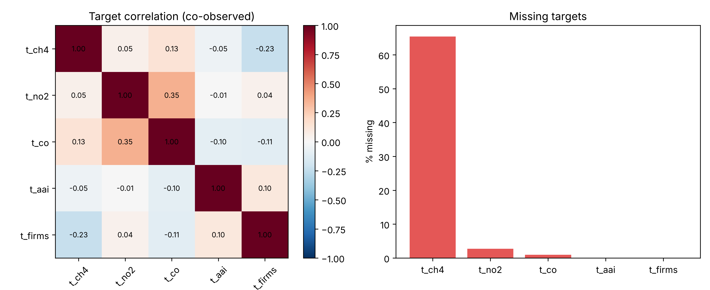
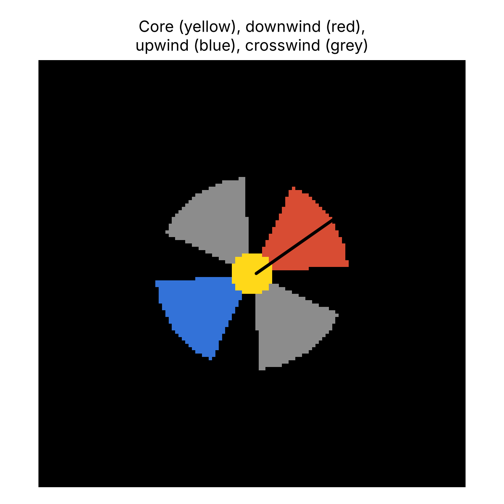
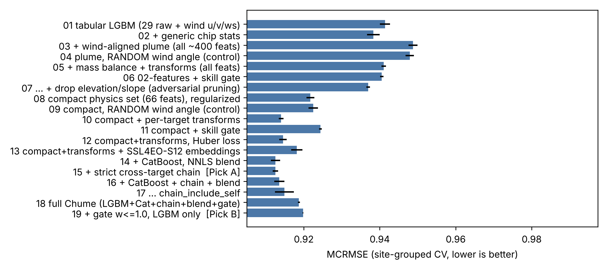
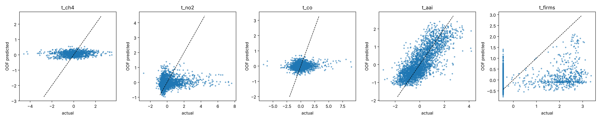
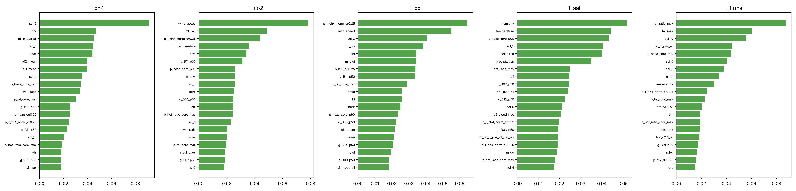

# 1. Project and team information

- Team name on Kaggle: **[team to fill]**
- Members (name, university, Kaggle username): **[team to fill]**
- Kaggle team / profile URL: **[team to fill]**
- Code: **[GitHub URL, code only]** / **[Kaggle notebook URL]** (`notebooks/chume_kaggle.ipynb`)
- Final private leaderboard MCRMSE / rank: **[fill after Nov 28]**

# 2. Problem understanding

For each of 4,439 samples (3,218 train, 1,221 test) we predict five atmospheric quantities measured by
Sentinel-5P/FIRMS over a 10 km window around an industrial facility: methane, NO2 and CO enhancements,
the absorbing aerosol index, and fire/flare thermal intensity. All targets are released as z-scores. Inputs
are a 384 × 384, 14-band Sentinel-2 L2A chip and 29 weather, terrain and spectral-index features. Targets are
blank where the satellite column was blocked (cloud, quality filtering); blanks are not scored. The metric is
masked mean column-wise RMSE (MCRMSE). Test facilities never appear in train, and the test period is
later than the training period.

**Central difficulty: generalizing to new sites.** Under site-grouped cross-validation, even the training
mean scores 1.0092, and 32-64% of each target's variance lies between sites.

**Original hypothesis:** physically motivated, wind-aligned, within-scene contrasts transfer across sites
better than generic image statistics. **What we found:** compact physics features (thermal-anomaly counts,
SWIR ratios, wind/mass-balance terms) do transfer better than generic statistics, but aligning them with
the wind direction adds nothing measurable (Section 5, key control).

# 3. Data exploration, preprocessing, feature engineering, missing targets

**Dataset facts** (`docs/DATA_NOTES.md`). Chips are 384 × 384 uint16 with bands B1-B9, B8A, B11, B12
(reflectance × 10⁴), SCL and the s2cloudless probability CLDPRB. There is no georeferencing, and each
frame is cropped to its facility, so pixel size varies between sites. Every facility sits at the chip
centre. Wind is given as ERA5-Land speed and meteorological (blowing-from) direction. There are 81
training sites with 4-72 rows each (median 39); test rows carry no site key.

{width=90%}

**Missing targets.** CH4 is missing in 65.4% of training rows, NO2 in 2.7%, CO in 0.9%; AAI and FIRMS are
complete. Blanks mean a blocked or invalid retrieval, not a zero enhancement, so each target is trained
only on rows where it was observed and is never imputed. CV folds are stratified on the availability
pattern. FIRMS is zero-inflated: 82.6% of rows sit at −0.439, the "no detection" floor. Targets correlate
only weakly; the strongest pair is NO2-CO at 0.35.

**Preprocessing.** DN/10⁴ to reflectance. The clear-sky mask removes SCL classes 0, 1, 3, 8, 9, 10 and any
pixel with CLDPRB ≥ 40 (the organizers' own cloud threshold).

**Feature families.**

- Generic chip statistics: per-band p10/p50/p90 and SCL class fractions.
- Derived SWIR layers: B12/B11 methane ratio (raw and normalised by the chip's clear-sky median, following
  Varon et al. 2021), the thermal anomaly index TAI = (B12−B11)/B8A, the B12/B8A hot ratio (Liu et al.
  2021), NDVI, NDBI, haze B01/B04.
- Wind-aligned regions: a core disk plus downwind, upwind and crosswind 60° cones at 0.10/0.25/0.45 of the
  chip half-width, giving mean/p90 per region, down-minus-up, down-minus-cross, core-minus-ring and a
  z-scored down-minus-up.
- Hot-pixel and TAI counts and maxima.
- Mass-balance terms (integrated-mass-enhancement literature): wind speed, 1/ws, log ws, heat proxies × 1/ws,
  methane down-up contrast × ws.
- SSL4EO-S12 embeddings, tested and rejected.

{width=40%}

# 4. Baseline models and lessons learned

| Model | CV MCRMSE (3 seeds) | std |
|---|---|---|
| Mean predictor (same site-grouped CV) | 1.0092 | — |
| 01 tabular LightGBM (29 raw features + wind u/v/ws) | 0.94137 | 0.00131 |
| 02 + generic chip statistics | 0.93833 | 0.00167 |

Generic chip statistics bought only 0.003, almost all of it on FIRMS. Adversarial validation shows why
they plateau: a classifier separates train from test with **AUC 0.997**. The most drifting features are
elevation, slope, the SCL water fraction and SWIR/plume statistics. Elevation and slope are nearly constant
within a site, so they act as site fingerprints. Test sites are higher on average (mean 461 m vs 173 m).

# 5. Experiments and methodology

**Stage 1.** Per-target LightGBM and CatBoost, each fitted only on observed rows. Early stopping uses an
inner site-grouped fold (never the validation fold); 3 model seeds per fold. Final hyper-parameters:

| | LightGBM | CatBoost |
|---|---|---|
| learning rate | 0.02 | 0.03 |
| leaves / depth | 7 leaves | depth 4 |
| regularization | min_data_in_leaf 80, L1 0.1, L2 1.0 | l2_leaf_reg 10 |
| subsampling | feature_fraction 0.5, bagging 0.8 | — |
| max rounds / early stop | 3000 / 150 | 2000 / 150 |

**Target transforms.** For each target we searched none, y·ws and signed log by out-of-fold (OOF) RMSE
in the original space. Signed log won for all five targets (heavy tails: NO2 skew 3.0, FIRMS 2.0, CO 1.7),
and it was the second-largest single gain: −0.0077.

**Stage 2: strict cross-target chain.** For each outer fold, stage-1 predictions for the outer-training
rows come from an inner site-grouped CV that never touches the outer validation fold. Predictions for the
validation fold and the test set come from models that never saw those rows. Target *k* is then refitted
on the original features plus the stage-1 predictions of the other four targets. Nesting is what keeps
the chain leak-free: a naive stack would feed in-sample stage-1 predictions that already encode each
training row's own label.

**Blend and gate.** Non-negative least-squares blend weights and the skill gate
`final = mean + w·(pred − mean)`, with w ∈ [0, 1.2], are both fitted fold-wise and nested. Gate weights in
the full model (seed 42 / 7 / 2026):

| | t_ch4 | t_no2 | t_co | t_aai | t_firms |
|---|---|---|---|---|---|
| gate w | 0.36 / 0.67 / 0.57 | 0.55 / 0.38 / 0.49 | 1.06 / 1.03 / 0.68 | 1.03 / 0.97 / 1.00 | 0.95 / 0.95 / 0.95 |

AAI and FIRMS keep their full predictions (w ≈ 1: real skill). CH4 and NO2 are shrunk about halfway,
meaning weak skill. Nevertheless, the gate **made every model worse** (rows 06, 11 and 18 below). It
shrinks toward the training mean, but at a new site the error is dominated by a shift of the mean itself,
so shrinkage throws away site-level signal without removing that bias. Pick A does not use it; Pick B
(conservative) uses it with w capped at 1.0, so it can only shrink (row 19).

**Ablations** (`docs/ABLATIONS.md`; site-grouped 5-fold CV, mean ± std over seeds 42, 7, 2026):

| Config | MCRMSE | std | CH4 | NO2 | CO | AAI | FIRMS |
|---|---|---|---|---|---|---|---|
| 01 tabular LGBM | 0.94137 | 0.00131 | 1.0128 | 0.9836 | 0.9878 | 0.6517 | 1.0710 |
| 02 + generic chip stats | 0.93833 | 0.00167 | 1.0104 | 1.0104 | 0.9898 | 0.6512 | 1.0299 |
| 03 + wind-aligned plume (~400 feats) | 0.94874 | 0.00119 | 1.0158 | 1.0438 | 1.0051 | 0.6701 | 1.0089 |
| 04 plume, random wind angle | 0.94789 | 0.00107 | 1.0128 | 1.0512 | 1.0042 | 0.6649 | 1.0064 |
| 05 + mass balance + transforms | 0.94104 | 0.00061 | 1.0069 | 1.0199 | 1.0030 | 0.6677 | 1.0077 |
| 06 02-features + gate | 0.94053 | 0.00044 | 1.0168 | 1.0140 | 0.9960 | 0.6568 | 1.0191 |
| 07 + drop elevation/slope | 0.93695 | 0.00045 | 1.0165 | 1.0068 | 1.0013 | 0.6564 | 1.0037 |
| 08 compact physics set (66), regularized | 0.92174 | 0.00106 | 1.0077 | 1.0149 | 0.9876 | 0.6507 | 0.9478 |
| 09 compact, random wind angle | 0.92248 | 0.00125 | 1.0088 | 1.0145 | 0.9883 | 0.6508 | 0.9500 |
| 10 compact + signed-log targets | 0.91403 | 0.00060 | 1.0033 | 0.9921 | 0.9879 | 0.6503 | 0.9365 |
| 11 compact + gate | 0.92439 | 0.00036 | 1.0155 | 1.0034 | 0.9913 | 0.6584 | 0.9533 |
| 12 10 + Huber loss | 0.91452 | 0.00098 | 1.0032 | 0.9925 | 0.9890 | 0.6506 | 0.9373 |
| 13 10 + SSL4EO-S12 embeddings | 0.91817 | 0.00148 | 1.0090 | 0.9720 | 1.0014 | 0.6525 | 0.9561 |
| 14 10 + CatBoost, NNLS blend | 0.91254 | 0.00123 | 0.9994 | 0.9911 | 0.9884 | 0.6464 | 0.9374 |
| **15 10 + strict chain (Pick A)** | **0.91252** | 0.00069 | 0.9980 | 0.9984 | 0.9895 | 0.6338 | 0.9429 |
| 16 10 + CatBoost + chain + blend | 0.91354 | 0.00134 | 0.9991 | 1.0031 | 0.9893 | 0.6325 | 0.9437 |
| 17 16 with chain_include_self | 0.91490 | 0.00250 | 1.0035 | 1.0031 | 0.9903 | 0.6368 | 0.9408 |
| 18 full Chume (+ gate) | 0.91871 | 0.00028 | 1.0114 | 0.9997 | 0.9925 | 0.6367 | 0.9532 |
| **19 10 + gate w ≤ 1.0, LGBM only (Pick B)** | **0.91979** | 0.00008 | 1.0145 | 0.9964 | 0.9919 | 0.6515 | 0.9446 |

{width=100%}

**The key control: true vs random wind angle.** Recomputing every plume feature with a random wind
direction gives 0.94789 against 0.94874 with the true direction on the full feature set (rows 03/04).
On the compact set it gives 0.92248 against 0.92174 (rows 08/09). Both differences are smaller than the
seed-to-seed std. So, on this data, **wind alignment carries no measurable signal beyond radial core-vs-ring
structure**. Plausible reasons:

- ERA5 daily wind quantized to 10° is a coarse proxy for the wind at the Sentinel-2 overpass.
- Chips are not georeferenced, so north-up orientation is unverified.
- Sentinel-2 detects methane only for very strong sources over homogeneous surfaces.
- The targets are 10 km Sentinel-5P window means, far coarser than any plume visible in a chip.

We report this negative result as the main scientific finding.

# 6. Validation and results

**CV protocol.** StratifiedGroupKFold by `site_key` (5 folds, stratified on the target-availability
pattern), repeated over seeds 42, 7 and 2026. Blend and gate are fitted nested within folds. A change
counts only if the mean over seeds improves by more than the seed-to-seed std. Each final submission
averages the test predictions of the three seed runs.

**Final CV.**

- Pick A: **0.91252 ± 0.00069** (CH4 0.9980, NO2 0.9984, CO 0.9895, AAI 0.6338, FIRMS 0.9429).
- Pick B (conservative: LightGBM only, gate capped at w ≤ 1.0): **0.91979 ± 0.00008**. It gives up 0.007 of
  CV for the lowest seed-to-seed variance of any model. Its gate sends CH4 almost entirely to the mean
  (w = 0.03-0.14) and halves NO2 (w ≈ 0.6). An earlier Pick B, a LightGBM + CatBoost blend (row 14,
  0.91254, public 1.13569), was replaced because it was effectively the same model as Pick A: same
  features, CV within 0.00002, test predictions correlated 0.92-0.99.
- Mean predictor: 1.0092.

AAI carries most of the skill. FIRMS improves substantially (0.94 vs 1.005). CH4, NO2 and CO stay close to
the mean, which is honest: at unseen sites they are barely predictable from these inputs.

{width=100%}

| Milestone | CV MCRMSE (3 seeds) | Public LB |
|---|---|---|
| Baseline 02 (tabular + generic chip stats) | 0.93833 | 1.15504 |
| Pick A: compact + signed log + strict chain | 0.91252 | 1.14134 |
| (earlier B) compact + signed log + LGBM/CatBoost blend | 0.91254 | 1.13569 |
| Pick B: compact + signed log, LGBM only, gate w ≤ 1.0 | 0.91979 | 1.13004 |

CV and the public leaderboard improve together, but the public scores sit about 0.22 higher (0.91 vs
1.13-1.14). The organizers anticipate this gap: test facilities and the later time period shift every
target relative to the training mean.

**Why the gap is larger than site-grouped CV predicts.** Site-grouped CV simulates new facilities drawn
from the training population, but the test set differs as a whole: an adversarial classifier separates
train from test with AUC 0.997 on all 447 features and still 0.979 on the final 66, driven by moisture and
surface descriptors (NMDI, SCL water fraction, bare-soil reflectance) and SWIR hot-pixel contrasts, on top
of a later observation period and higher terrain (mean elevation 461 m vs 173 m). The per-site offsets the
model learns from 81 training sites therefore transfer only partly, so CV over-states skill at test sites;
this is also why the conservative Pick B, which shrinks CH4 and NO2 toward the mean, scores best on the
public split (1.130) despite the worst CV of the three, although we did not select on it.

{width=100%}

**Are the physics features near the top?**

- **FIRMS: yes.** The top features are `hot_ratio_max` (B12/B8A) and `tai_max`, then the SCL
  thin-cirrus fraction and the TAI pixel count.
- **NO2:** wind speed and `mb_ws` lead, the dilution signature of the mass-balance argument.
- **CO:** the core-minus-ring B12/B11 ratio and wind speed lead.
- **CH4: no.** Its top feature is the SCL water fraction (`scl_6`), consistent with Sentinel-2's weak
  methane sensitivity.
- **AAI:** humidity, temperature and core haze lead (dust and smoke conditions).

# 7. Findings and limitations

**What worked, ranked by CV gain:**

1. A compact, regularized physics feature set instead of all ~470 features: −0.0152.
2. Signed-log target transform: −0.0077.
3. Dropping the site-fingerprint features elevation/slope (adversarial pruning): −0.0036.
4. Strict nested cross-target chain, or a CatBoost + LightGBM NNLS blend: −0.0015 each, not additive.

**What didn't work:**

- The full set of ~400 wind-aligned plume features: +0.0104 vs generic stats.
- Wind alignment itself: no effect against the random-angle control.
- The skill gate: +0.0022 to +0.0052 depending on the model (rows 06, 11, 18).
- SSL4EO-S12 embeddings: +0.0041 overall, though they helped NO2.
- Huber loss: no gain.
- `chain_include_self`: +0.0014 vs row 16.
- Combining CatBoost, chain and blend: +0.0010 over either alone.
- Site-context features: not applicable, because test has no site key and inferring site membership is
  prohibited.

**Limitations:**

- Sentinel-2's methane sensitivity is limited to strong sources over homogeneous surfaces.
- Single scene only; no multi-pass reference is allowed.
- The wind convention and north-up orientation could not be verified, since chips are not georeferenced.
- Chip footprints differ by site.
- Sentinel-2 has no UV band analogous to the AAI.
- Only 81 training sites, so CV variance is high, and train vs test separates almost perfectly
  (AUC 0.997).

**Future work:**

- Multi-temporal per-site references, if allowed.
- Physically simulated plume augmentation.
- Uncertainty-aware shrinkage toward a predicted site level rather than the global mean.

# 8. Code and reproducibility

- **Repository:** `src/chume/` is the package. Run `pip install -e ".[dev,geo]"`, then
  `bash scripts/download.sh`, then `bash scripts/run_all.sh`. Configs: `configs/final.json` (Pick A) and
  `configs/final_B.json` (Pick B, conservative). Pinned versions are in `requirements.txt` (Python 3.13). Seeds are
  42, 7 and 2026.
- **Hardware:** 4 CPU cores, 15 GB RAM, no GPU.
- **Runtime:** feature build about 2 min per pass; Pick A about 1 min per seed; full `run_all.sh` about
  1 hour.
- **Kaggle notebook** (`notebooks/chume_kaggle.ipynb`): embeds the package source, rebuilds features from
  `/kaggle/input/obscura` and trains Pick A over the three seeds. Checked locally to reproduce the
  submitted file exactly (max abs diff 0.0) in 3 min 52 s.
- **Disclosures:**
  - Libraries: numpy, pandas, pyarrow, scikit-learn, SciPy, LightGBM, CatBoost, rasterio/tifffile,
    matplotlib, PyYAML, joblib.
  - Tested but not in the final submissions: PyTorch, timm and the pretrained SSL4EO-S12 ResNet50 MoCo
    checkpoint (`resnet50_sentinel2_all_moco`, published by TorchGeo on Hugging Face).
  - The final submissions use no pretrained models. No external data was used.
- **Rules compliance:** no external data; no attempt to identify sites, locations or dates; no
  leaderboard probing; no use of file metadata, row order, IDs or file names; no hand labelling. Leak
  checks (duplicate and near-duplicate chips across splits) found nothing. No competition data, chips or
  targets are in the repository.
